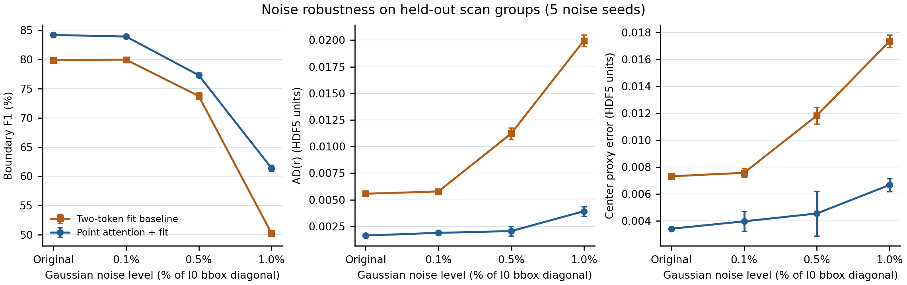

# 加噪边界检测与圆拟合实验（2026-11-02）



## 协议

- 固定两份已训练 60 轮的模型：`point_attention` 与没有点间 attention 的 `fit`。二者均用 `balanced` 扫描组划分，测试组为 10、11；没有为本实验重新训练或选择检查点。
- 测试集有 162 个 `l0/l1` patch 对，其中 160 个含目标圆、2 个不含圆。八种半径各 20 个含圆 patch。分类在全部 patch 的 500 个查询点上统计；圆参数误差只在 160 个含圆 patch 上统计。
- 对两个输入的 XYZ 分别添加独立的各向同性高斯噪声 `N(0, σ²)`。每个样本的 `σ = 噪声百分比 / 100 × 原始 l0 包围盒对角线`。测试集该对角线的中位数为 `0.304057`，所以三档 `σ` 的中位数分别为 `0.000304`、`0.001520`、`0.003041`（HDF5 坐标单位）。`0%` 指原始数据，**不能假设它完全无噪声**。
- 五个随机种子 42–46。两模型使用完全相同的扰动；同一随机种子在三档噪声中复用同一组标准正态样本并按 `σ` 缩放。标签始终对应原始点身份，没有因坐标扰动而重新标注。点分类的判定阈值为 0.5。
- 圆拟合只使用模型预测的软边界概率、拟合权重和法向，不使用 GT 掩码。含圆样本由 GT 半径编码选出以计算圆参数指标，因此本实验衡量的是**已知含圆 patch 的参数精度**，不是整云多圆发现率。

## 指标

令 `K=160`，预测圆心与半径为 `ĉ_j, r̂_j`，标称半径为 `r_j`。论文的定义是：

`AD(c) = Σ_j ||ĉ_j − c_j||₂ / K`，`AD(r) = Σ_j |r̂_j − r_j| / K`，`MSE(r) = Σ_j (r̂_j − r_j)² / K`。

本 HDF5 **不含 CAD 圆心真值 `c_j`**。下表的 `AD(c)代理` 用原始（未额外加噪）GT 边界点和 HDF5 法向经 `weighted_circle_fit` 拟合出的中心作为固定参考，计算 `Σ_j ||ĉ_j − c_j^proxy||₂ / K`。它与论文的真实 `AD(c)` **不是同一个指标**。`AD(r)` 和 `MSE(r)` 使用 HDF5 半径编码对应的标称半径。P/R/F1 分别是逐点边界分类的精确率、召回率和调和平均。

所有距离为 **HDF5 原始坐标单位**，MSE 为该单位的平方；没有可靠的毫米换算。论文没有给出噪声百分比所参照的长度尺度，因此本实验的 0.1%、0.5%、1% 与论文噪声强度不能直接等同。

论文表 3 的标题明确指定 `AD(c)`、`AD(r)` 为 **mm**，`MSE(r)` 为 **mm²**。设一个 HDF5 坐标单位等于 `s` mm，则本地 `AD(c)代理`、`AD(r)` 转成 mm 要乘 `s`，`MSE(r)` 转成 mm² 要乘 `s²`。论文没有给出这份 HDF5 的 `s`，文件本身也没有单位属性，原始实现里没有可确认的换算。**不能仅因本地原始数值较小，就判定新模块优于论文表 3 的方法。**若额外假设 HDF5 使用米（`s=1000`），三档噪声的本地 `AD(c)代理` 为 `3.961`、`4.544`、`6.662` mm，`AD(r)` 为 `1.895`、`2.058`、`3.925` mm，`MSE(r)` 为 `18.327`、`34.388`、`60.343` mm²；这只是条件换算，不是已确认的物理单位。`AD(c)代理` 与论文 CAD 圆心误差即使换算单位也不能直接比较。

## 结果

有噪声行是五个随机种子的**均值 ± 样本标准差**；原始行只评估一次。

| 模型 | 额外噪声 | Precision % | Recall % | F1 % | AD(c)代理 | AD(r) | MSE(r) |
|---|---:|---:|---:|---:|---:|---:|---:|
| 点间 attention | 原始 | 80.85 | 87.82 | 84.19 | 0.003411 | 0.001644 | 4.801e-06 |
| 点间 attention | 0.1% | 80.63 ± 0.18 | 87.51 ± 0.22 | 83.93 ± 0.10 | 0.003961 ± 0.000738 | 0.001895 ± 0.000175 | 1.833e-05 ± 1.173e-05 |
| 点间 attention | 0.5% | 76.96 ± 0.42 | 77.65 ± 0.70 | 77.30 ± 0.43 | 0.004544 ± 0.001665 | 0.002058 ± 0.000451 | 3.439e-05 ± 5.849e-05 |
| 点间 attention | 1.0% | 63.36 ± 0.32 | 59.58 ± 0.79 | 61.41 ± 0.49 | 0.006662 ± 0.000494 | 0.003925 ± 0.000448 | 6.034e-05 ± 3.708e-05 |
| 双 token 拟合基线 | 原始 | 72.49 | 88.92 | 79.87 | 0.007308 | 0.005568 | 2.076e-04 |
| 双 token 拟合基线 | 0.1% | 72.91 ± 0.32 | 88.53 ± 0.15 | 79.96 ± 0.17 | 0.007567 ± 0.000315 | 0.005784 ± 0.000191 | 2.053e-04 ± 7.588e-06 |
| 双 token 拟合基线 | 0.5% | 69.98 ± 0.55 | 77.93 ± 0.71 | 73.74 ± 0.55 | 0.011816 ± 0.000613 | 0.011219 ± 0.000525 | 4.793e-04 ± 3.079e-05 |
| 双 token 拟合基线 | 1.0% | 44.71 ± 0.47 | 57.41 ± 0.57 | 50.27 ± 0.48 | 0.017340 ± 0.000464 | 0.019945 ± 0.000536 | 8.710e-04 ± 3.538e-05 |

无噪声的点间 attention 结果与此前 `eval_v2.py` 测试值完全一致。1% 额外噪声下，点间 attention 模型的 F1 为 `61.41%`，比双 token 基线高 `11.14` 个百分点；`AD(r)` 为 `0.003925`，基线为 `0.019945`。但点间 attention 模型本身相较原始数据的 F1 也下降了 `22.78` 个百分点，说明强噪声下仍明显退化。

小孔受影响更明显：最小标称半径 `0.005` 的 20 个 patch，点间 attention 的 F1 从 `0.667` 降到 1% 噪声下的 `0.369`，`AD(r)` 从 `0.003379` 增至 `0.010643`。噪声标准差的样本中位数 `0.003041` 已接近该半径的 61%。

## 复现

在本目录使用 `circlenet-repro` 环境，并将原始 HDF5 数据放在 `data/circle_data/data.hdf5`。若没有本地检查点，先从头训练两份 60 轮模型：

```bash
python train_v2.py --epochs 60 --batch-size 8 --lr 3e-4 \
  --warmup-epochs 20 --seed 42 --split-protocol balanced --model fit \
  --out-dir log/v2_balanced_20261102

python train_v2.py --epochs 60 --batch-size 8 --lr 3e-4 \
  --warmup-epochs 20 --seed 42 --split-protocol balanced --model point_attention \
  --out-dir log/point_attention_balanced_20261102

python eval_noise.py \
  --checkpoint log/point_attention_balanced_20261102/last_model.pth \
  --split test --noise-percent 0.1 0.5 1.0 --seeds 42 43 44 45 46 \
  --out log/point_attention_balanced_20261102/noise_test.json

python eval_noise.py \
  --checkpoint log/v2_balanced_20261102/last_model.pth \
  --split test --noise-percent 0.1 0.5 1.0 --seeds 42 43 44 45 46 \
  --out log/v2_balanced_20261102/noise_test.json

python figures/plot_noise_robustness.py \
  --point-attention log/point_attention_balanced_20261102/noise_test.json \
  --baseline log/v2_balanced_20261102/noise_test.json \
  --out-prefix figures/noise_robustness
```

完整逐种子、逐半径结果保存在上述两个本地 JSON。此实验是在**已训练模型上做测试时扰动**；论文使用不同噪声和采样密度的虚拟扫描数据进行训练与测试，且有 CAD 圆心真值，因此两者不构成严格复现或数值对照。

同一 HDF5 测试集上普通代数最小二乘（LLS）与当前模型的拟合对照见 [LLS_NOISE_COMPARISON.md](LLS_NOISE_COMPARISON.md)。
