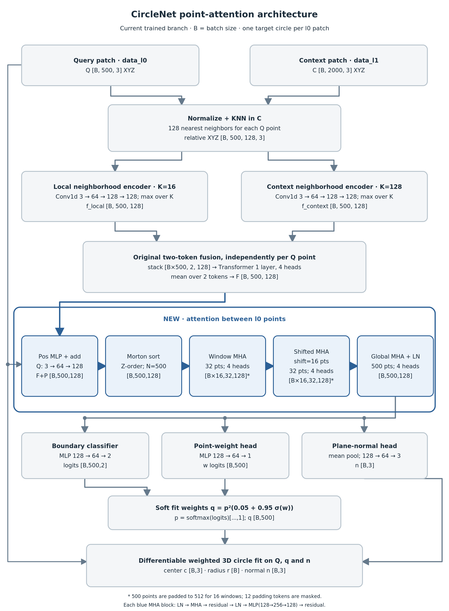

# 当前点间 Attention 网络结构图



对应实现：`../model_point_attention.py`、`../model_v2.py`、`../repro_model.py`。图中 `B` 是 batch size；绘制的是当前训练的 `CircleNetPointAttention` 分支在推理时的流程。

- 输入从 `data_l0` 和 `data_l1` 中只取 XYZ 三列，分别为 `[B,500,3]` 和 `[B,2000,3]`。每个 `l0` 样本对应一个待拟合圆。
- 旧主干先为每个 `l0` 点从 `l1` 取 128 个邻点，16 点和 128 点两支分别编码。旧 Transformer 的序列长度为 **2**，即每个查询点的两种邻域特征。
- 新增的点间模块先按 Morton 顺序排列 500 个查询点，再做长度 32 的普通窗口 attention、移动 16 点的窗口 attention，以及长度 500 的全局 attention。每层宽度 128，4 个头，每头 32 维。窗口 attention 为 500 点补 12 个 masked token，因此每批有 `B×16` 个长度为 32 的窗口。
- 三个预测头分别输出逐点边界 logits `[B,500,2]`、逐点权重 logits `[B,500]` 和单位平面法向 `[B,3]`。可微加权代数圆拟合使用原始查询点、软权重及法向，得到圆心 `[B,3]` 和半径 `[B]`。

蓝色模块借鉴了 PTv3 的点排序和局部窗口思路，是本仓库的简化实现；它没有使用官方 PTv3 或 Sonata 权重。最后的圆参数由可微解析拟合产生，不是单独的圆参数回归头。

图为可编辑 SVG，附有 PNG 和 PDF 导出文件。重新生成：

```bash
python draw_point_attention_architecture.py
```
